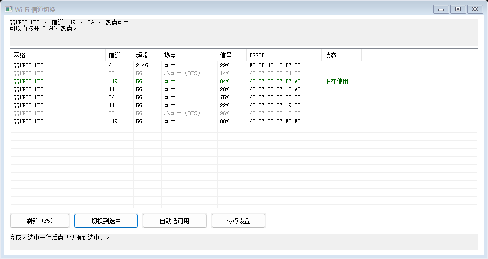

# WLAN_Monitor

Windows 移动热点辅助工具：把 Wi-Fi 连接切到**非 DFS 的 5 GHz 信道**，让软 AP（移动热点）能以 5 GHz 启起来。

单文件 Win32 + WlanAPI 实现，纯 C++，无第三方依赖。



## 背景

Windows 的移动热点走 SoftAP，**软 AP 不能落在 DFS 信道**（5 GHz 的 52-64、100-144 需要雷达检测，软 AP 不做 CAC）。

校园网 `QQHRIT-H3C` 有好几个 BSSID，系统按信号强度自选，常常选中信号最强的 DFS 信道：

```
ch36  非DFS   ✔
ch44  非DFS   ✔
ch52  DFS    ← 信号最强，系统默认选它 → 强制 5 GHz 时 StartTetheringAsync 返回 WiFiDeviceOff
ch60  DFS
ch149 非DFS   ✔
```

于是「热点一点开就自动关」。本工具把 STA 钉到非 DFS 的 BSSID 上，热点立刻就能以 5 GHz 启动（实测 `Success / On`，稳定运行）。

详细排查过程见 [docs/热点故障诊断报告.md](docs/热点故障诊断报告.md)。

## 界面

```
QQHRIT-H3C · 信道 149 · 5G · 热点可用
可以直接开 5 GHz 热点。

网络            信道  频段  热点            信号  BSSID              状态
QQHRIT-H3C      6     2.4G  可用            29%   EC:CD:4C:13:D7:50
QQHRIT-H3C      52    5G    不可用（DFS）    14%   6C:87:20:28:34:C0   ← 整行灰显
QQHRIT-H3C      149   5G    可用            84%   6C:87:20:27:B7:A0   正在使用（绿）
QQHRIT-H3C      36    5G    可用            75%   6C:87:20:28:05:20

[ 刷新 (F5) ] [ 切换到选中 ] [ 自动选可用 ] [ 热点设置 ]
完成。选中一行后点「切换到选中」。
```

| 元素 | 说明 |
|---|---|
| 顶部第一行 | 当前网络 · 信道 · 频段 · 热点可用/不可用 |
| 顶部第二行 | 一句话结论：能不能直接开 5 GHz 热点 |
| 热点列 | `可用` / `不可用（DFS）`，DFS 行整行灰显 |
| 状态列 | `正在使用` 标绿 |
| 刷新 (F5) | `WlanScan` + 4 秒等待 + 重新枚举 |
| 切换到选中 | `WlanConnect` + `pDesiredBssidList` 钉到指定 BSSID（双击行同效） |
| 自动选可用 | 自动挑信号最强的可用（非 DFS）BSSID |
| 热点设置 | 打开 `ms-settings:network-mobilehotspot` |

## 使用

1. 双击 `bin\WLAN_Monitor.exe`，UAC 点是（**必须管理员运行**，见下）
2. 等 4 秒扫描完成
3. 看「状态」列显示「正在使用」的那一行
   - 若「热点」列是「不可用（DFS）」→ 点任意一行「可用」的，再点「切换到选中」
   - 或直接点「自动选可用」
4. 状态栏出现「已切换到 XX · 信道 36（5G），现在可以开 5 GHz 热点了」，就去开热点

### 命令行模式

```powershell
# 只读自检，输出 selftest.txt
.\WLAN_Monitor.exe --selftest

# 直接钉到指定 BSSID，输出 pin.txt
.\WLAN_Monitor.exe --pin 6C:87:20:28:05:20
```

## 构建

### Visual Studio

打开 `WLAN_Monitor.sln`，选 `Release | x64`，F7。输出在 `out\x64\Release\WLAN_Monitor.exe`。

### 命令行

```bat
build.bat
```

内部调用 `cl`：

```
cl /std:c++17 /EHsc /O2 /utf-8 /WUNICODE src\WLAN_Monitor.cpp ^
   /link /MANIFEST:EMBED /MANIFESTUAC:"level='requireAdministrator' uiAccess='false'" ^
   wlanapi.lib comctl32.lib shell32.lib user32.lib gdi32.lib
```

## 目录结构

```
WLAN_Monitor/
├─ src/WLAN_Monitor.cpp     全部源码（约 750 行）
├─ docs/ui.png              界面截图
├─ docs/热点故障诊断报告.md  问题定位全过程
├─ bin/WLAN_Monitor.exe     预编译产物（未纳入 git）
├─ build.bat                命令行一键编译
├─ WLAN_Monitor.sln / .vcxproj
├─ .gitignore / .gitattributes
└─ README.md
```

## 为什么必须管理员运行

实测这台机器上**非提权进程调用 `WlanQueryInterface(current_connection)` 会被拒绝（`ERROR_ACCESS_DENIED` / rc=5）**，提权后返回 0。

排查过：位置权限（`ConsentStore\location` 与其 `NonPackaged`）全部 Allow、`lfsvc` 运行中、WMI 正常；用 `runas /trustlevel:0x20000` 与提权进程做对照，确认是令牌上下文导致。因此 exe 内嵌 `requireAdministrator` 清单。

## 已知限制

- **漫游会失效**：系统一旦漫游回 DFS 信道（信号最强），5 GHz 热点会再次启动失败，重新点「自动选可用」即可。
- **BSSID 随位置变化**：换地点先刷新再选。
- **6 GHz 用不了**：`IsBandSupported(SixGigahertz) = False`，Windows 热点 API 上限就是 5 GHz（BE200 硬件本身支持 6 GHz）。
- 只改变「连到哪个 BSSID」，不改注册表、不改系统设置。

## 实现踩坑记录

1. `wlan_intf_opcode_channel_number` 的输出参数是 `PVOID*`（需 `WlanFreeMemory` 释放），不能直接传 `ULONG` 的地址，否则读出垃圾值（曾出现 `-848914976`）。
2. 热点开启时 `WlanEnumInterfaces` 会多出 Wi-Fi Direct 的 AP 接口，对它的 `current_connection` 查询返回 `ERROR_ACCESS_DENIED`。选接口时必须逐个探测、挑「真正有 SSID 关联」的那个。
3. `WLAN_BSS_ENTRY` 的字段名是 `uLinkQuality` / `dot11BssPhyType`，不是 `wlanSignalQuality`。
4. 控件 ID 不能叫 `IDC_PIN`，会与 `winuser.h` 的光标宏冲突，统一加前缀。
5. `/MANIFEST:EMBED` 必须显式指定，否则只生成外部 `.manifest`，exe 内没有资源段。
6. 默认 GUI 字体下 `✘ / ✔` 会退化显示，界面改用纯文字「可用 / 不可用（DFS）」。
